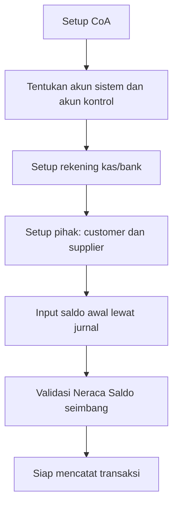
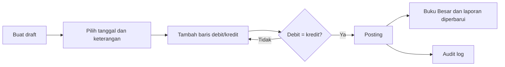
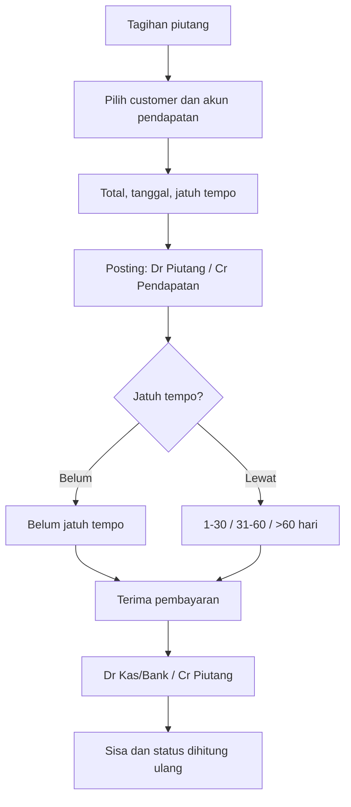
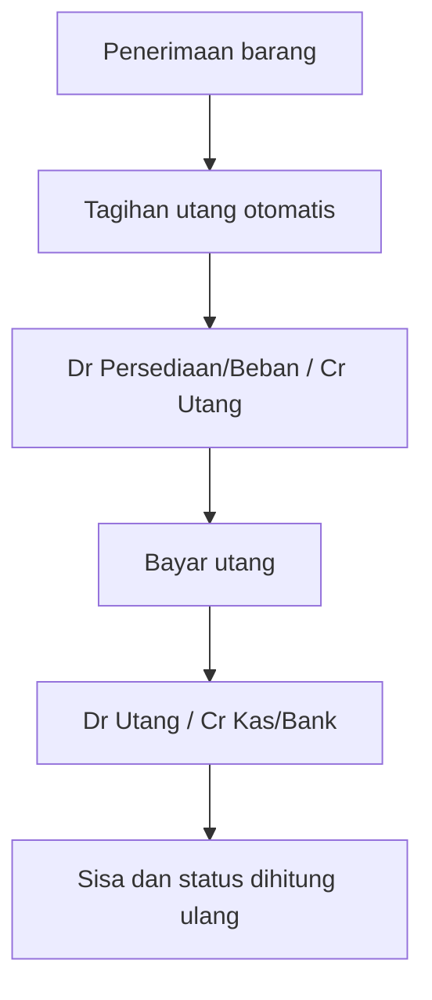
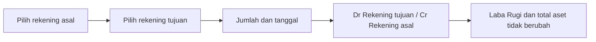
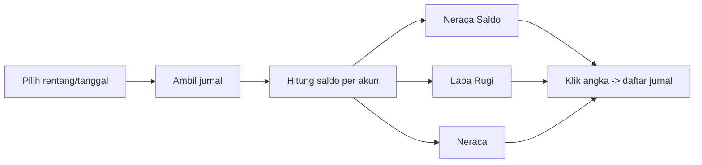
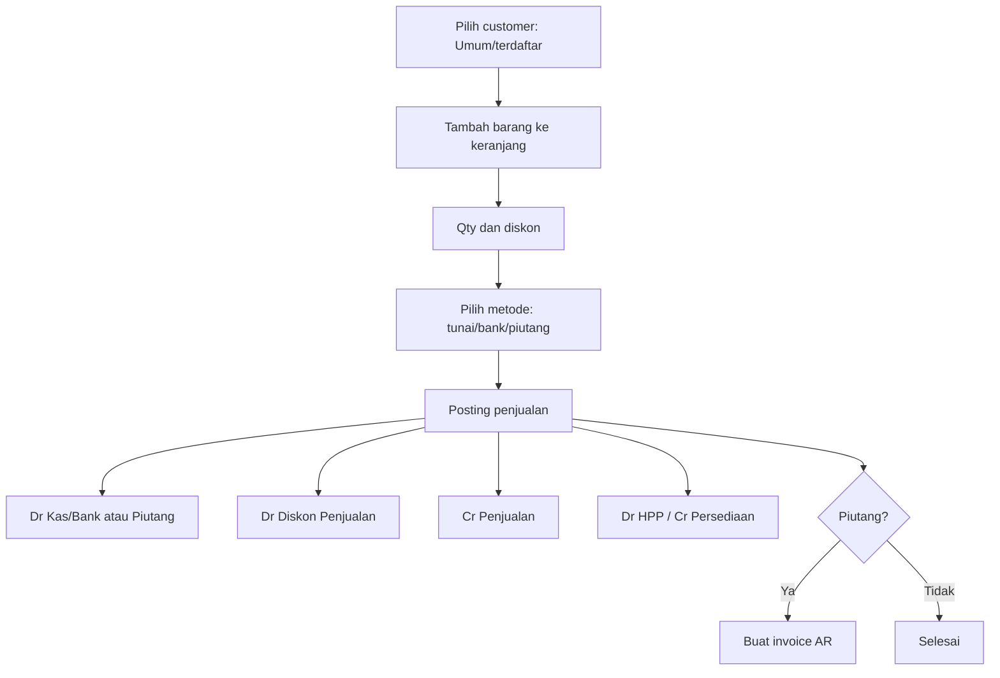

# Flow Finance — Blueprint Modul Keuangan ERP

Versi: 1.0  
Tanggal: 16 November 2026  
Dokumen pasangan: [`flow-logistic.md`](./flow-logistic.md)  
Referensi implementasi: prototipe `erp-finance-mvp` di repository ini

## 0. Cara memakai dokumen ini

Dokumen ini adalah **blueprint konsep dan layout dasar**, bukan spesifikasi yang terikat pada satu framework. Tujuannya agar flow keuangan yang sama bisa dipasang ke sistem ERP lain tanpa mengubah logika inti.

Gunakan bagian-bagian berikut sesuai kebutuhan:

| Bagian | Sifat | Bisa diadaptasi? |
| --- | --- | --- |
| Prinsip akuntansi, status, posting matrix | Wajib dipertahankan | Tidak |
| Nama modul dan istilah | Boleh disesuaikan bahasa/istilah sistem | Ya |
| Data model dan API contract | Bisa dipetakan ke database/API yang ada | Ya, selama invariant tetap |
| Layout dan wireframe | Referensi UX | Ya, mengikuti design system target |
| Token warna, komponen, ikon, font | Placeholder | Ya, wajib dipetakan |
| Role dan permission | Berbasis capability | Ya, dipetakan ke role sistem target |
| Acceptance test | Definition of done | Ya, ditambah test sistem target |

**Aturan utama:** jangan menulis angka laporan secara langsung. Semua laporan harus dihitung dari jurnal. Jangan memakai warna atau komponen dari prototipe ini jika sistem target punya design system sendiri.

## 1. Tujuan dan ruang lingkup

Modul Finance adalah pusat pencatatan dan pelaporan keuangan:

- Chart of Accounts (CoA)
- Jurnal Umum dan jurnal otomatis
- Buku Besar
- Neraca Saldo
- Laba Rugi
- Neraca
- Piutang Usaha
- Utang Usaha
- Kas dan Bank
- Rekonsiliasi subledger
- Laporan dan alat telusur

**Opsional / dapat diaktifkan di sistem lain:**

- Kasir/POS dan penjualan tunai/bank/piutang
- Diskon penjualan
- Approval jurnal atau approval dokumen sumber
- Multi-currency
- Pajak (PPN/PPh)
- Penutupan periode
- Rekonsiliasi bank
- Penyusutan aset tetap
- Pusat biaya/departemen

**Di luar cakupan versi dasar:** payroll, pajak, aset tetap, konsolidasi multi-entitas, dan multi-currency. Jika dibutuhkan, tambahkan sebagai modul perluasan tanpa mengubah inti double-entry.

### 1.1 Flag konfigurasi untuk sistem lain

| Flag | Default | Efek |
| --- | --- | --- |
| `finance.pos.enabled` | sesuai sistem | Mengaktifkan Kasir/POS dan HPP penjualan |
| `finance.approval.enabled` | false | Menampilkan approval jurnal/dokumen |
| `finance.tax.enabled` | false | Field PPN/PPh dan akun pajak |
| `finance.multi_currency.enabled` | false | Kurs, akun selisih kurs, dan format multi-currency |
| `finance.period_close.enabled` | false | Periode, soft close, hard close |
| `finance.bank_reconciliation.enabled` | false | Impor mutasi dan pencocokan bank |
| `finance.cost_center.enabled` | false | Pusat biaya pada baris jurnal |
| `finance.discount_account.enabled` | true | Akun Diskon Penjualan terpisah untuk POS |

Jika flag dimatikan, jangan tampilkan menu/field terkait dan jangan mengubah posting matrix inti.

### 1.2 Integrasi dengan sistem lain

- **Sudah punya general ledger:** pakai blueprint ini sebagai kontrak UI dan posting; kirim jurnal ke GL existing lewat accounting service, jangan membuat ledger kedua.
- **Sudah punya AP/AR:** pertahankan subledger existing; yang wajib adalah kontrol akun dan rekonsiliasi.
- **Sudah punya POS:** POS menjadi sumber invoice penjualan; Finance hanya membaca dan melunasi piutang.
- **Sudah punya approval engine:** map capability ke workflow existing; jangan membuat approval baru yang paralel.
- **Sudah punya bank feed:** transfer tetap jurnal; rekonsiliasi bank menjadi adapter terpisah.

## 2. Prinsip inti

1. **Jurnal adalah sumber kebenaran.** CoA, Buku Besar, Neraca Saldo, Laba Rugi, dan Neraca tidak menyimpan saldo independen.
2. **Double-entry.** Setiap jurnal minimal dua baris dan total debit = total kredit.
3. **Dokumen posted bersifat immutable.** Koreksi memakai jurnal pembalik, void dengan alasan, atau dokumen lawan.
4. **Subledger harus rekonsiliasi dengan akun kontrol.** Total piutang per pelanggan = saldo akun Piutang Usaha; total utang per supplier = saldo akun Utang Usaha.
5. **Pemisahan tugas.** Pembuat, penyetuju, pem-posting, dan pembayar sebaiknya bukan orang yang sama.
6. **Tanggal transaksi dan tanggal posting dipisahkan.** Laporan memakai tanggal transaksi; audit memakai keduanya.
7. **Status pembayaran dihitung, bukan disimpan.** `sisa = total - retur - pembayaran`, sehingga tidak bisa tidak sinkron.
8. **Nilai uang disimpan sebagai integer minor unit.** Hindari floating point. Format tampilan diserahkan ke adapter locale.
9. **Setiap perubahan saldo harus punya jejak.** Siapa, kapan, dokumen sumber, dan alasan.

## 3. Aktor dan capability

Jangan mengikat implementasi pada nama role. Gunakan capability, lalu map ke role sistem target.

| Capability | Contoh role | Boleh |
| --- | --- | --- |
| `finance.view` | Auditor, Manager, Staff | Lihat dashboard, jurnal, laporan |
| `coa.manage` | Finance Admin | Tambah/ubah/nonaktifkan akun |
| `journal.create` | Finance Staff | Buat draft jurnal |
| `journal.post` | Finance Staff/Manager | Posting jurnal |
| `journal.void` | Finance Manager | Void jurnal dengan alasan |
| `ar.manage` | Finance Staff | Buat tagihan piutang, terima pembayaran |
| `ap.manage` | Finance Staff | Bayar utang, kelola tagihan |
| `cash.manage` | Finance Staff | Rekening dan transfer |
| `report.view` | Manager, Auditor | Laporan dan drill-down |
| `period.close` | Finance Manager | Tutup/buka periode |
| `finance.settings` | Admin | CoA, metode bayar, ambang, penomoran |

**Pemisahan tugas minimum:**

- Pembuat jurnal manual tidak boleh mem-posting jurnal yang sama, kecuali admin dengan catatan override.
- Penerimaan barang hanya di modul Logistik; pembayaran utang hanya Finance.
- Approval PR/PO dapat berada di Finance atau role Approver terpisah, tergantung sistem.
- Auditor bersifat read-only.

**Mapping ke prototipe referensi:** role `Finance` memegang seluruh capability keuangan; role `Logistik` tidak membuka modul Finance. Dokumen blueprint ini mendukung pemisahan role yang lebih rinci untuk sistem target.

## 4. Peta modul

| Modul | Fungsi | Wajib |
| --- | --- | --- |
| Dashboard | Ringkasan kas/bank, piutang, utang, laba, persamaan, aging, approval | Ya |
| Chart of Accounts | Daftar akun, tipe, saldo normal, status, akun sistem | Ya |
| Jurnal Umum | Input jurnal manual, validasi seimbang, posting/void | Ya |
| Buku Besar | Mutasi per akun dan saldo berjalan | Ya |
| Laporan | Neraca Saldo, Laba Rugi, Neraca, drill-down, cetak/ekspor | Ya |
| Piutang | Tagihan pelanggan, pembayaran, aging, riwayat | Ya |
| Utang | Tagihan supplier, pembayaran, riwayat, retur | Ya |
| Kas dan Bank | Daftar rekening, saldo, transfer, buku besar rekening | Ya |
| Persetujuan | Approval jurnal/dokumen sumber | Opsional |
| Customer/Supplier | Pihak untuk AR/AP dan transaksi operasional | Ya, bisa berbagi dengan modul lain |
| Kasir/POS | Penjualan, diskon, HPP, pembayaran, piutang | Opsional |
| Pengaturan | Metode bayar, ambang, nomor, periode | Ya |

## 5. Flow utama

### 5.1 Setup awal dan saldo awal



Aturan:

- Saldo awal tidak diketik ke laporan; dibuat lewat jurnal pembukaan.
- Akun kontrol AR/AP/Persediaan sebaiknya dikunci dari jurnal manual setelah modul operasional aktif.
- Jangan memakai akun pendapatan/beban untuk saldo awal aset.

### 5.2 Jurnal manual



Aturan:

- Minimal dua baris.
- Satu baris hanya debit atau kredit.
- Akun nonaktif tidak bisa dipakai.
- Akun sistem yang dikunci tidak muncul di jurnal manual.
- Jurnal draft boleh diedit; jurnal posted tidak.
- Void memakai jurnal pembalik atau status void dengan alasan dan audit log.

### 5.3 Piutang (AR)



Aturan:

- Pembayaran boleh sebagian dan tidak boleh melebihi sisa.
- Aging dihitung dari `due_date` terhadap tanggal laporan.
- Retur penjualan, jika ada, mengurangi tagihan lewat dokumen kredit.
- Invoice dari POS/Kasir memakai customer terdaftar; jangan membuat invoice duplikat manual.

### 5.4 Utang (AP)



Aturan:

- PO tidak membuat utang; utang lahir saat penerimaan barang.
- Pembayaran tidak boleh melebihi sisa.
- Retur pembelian mengurangi utang; jika sudah dibayar, menjadi Piutang Supplier.
- Aging utang dapat ditambahkan di fase lanjutan.

### 5.5 Kas, bank, dan transfer



Aturan:

- Rekening adalah akun aset yang ditandai `is_cash_bank`.
- Transfer bukan pendapatan atau beban.
- Saldo rekening harus sama dengan saldo Buku Besar akunnya.
- Rekonsiliasi bank adalah modul terpisah, bukan syarat MVP.

### 5.6 Laporan dan drill-down



Aturan:

- Laba Rugi memakai rentang tanggal.
- Neraca memakai satu tanggal posisi.
- Laba berjalan dihitung sejak awal tahun buku dan masuk ekuitas.
- Baris pengecekan Neraca harus 0.
- Setiap angka laporan bisa ditelusuri ke jurnal.

### 5.7 Opsional: Kasir/POS



Aturan:

- Diskon persen dihitung dari subtotal, lalu potongan nominal.
- Penjualan piutang wajib customer terdaftar; tunai/bank boleh Umum.
- HPP memakai moving average.
- Stok berkurang pada saat posting penjualan.
- Void/retur penjualan adalah fase lanjutan.

## 6. Status dan lifecycle

### 6.1 Akun

`active` → `inactive`  
`system`/`locked` tidak bisa dihapus atau dinonaktifkan.

### 6.2 Jurnal

```text
draft → posted → voided/reversed
```

- `draft`: boleh diedit.
- `posted`: memengaruhi laporan.
- `voided`: tidak memengaruhi laporan; alasan wajib.
- Koreksi lebih disarankan memakai jurnal pembalik eksplisit.

### 6.3 Invoice AR/AP

Dokumen: `draft → posted → voided`  
Status pembayaran (dihitung): `unpaid → partial → paid` dan `overdue` untuk tampilan.

### 6.4 Pembayaran

`draft → posted → voided` (jika sistem mendukung void).

### 6.5 Periode (opsional)

`open → soft_closed → closed`  
Posting ke periode closed harus ditolak atau memerlukan override dengan audit log.

## 7. Posting matrix

| Kejadian | Debit | Kredit | Catatan |
| --- | --- | --- | --- |
| Jurnal manual | Sesuai input | Sesuai input | Harus seimbang |
| Tagihan piutang | Piutang Usaha | Pendapatan | + diskon jika ada |
| Pembayaran piutang | Kas/Bank | Piutang Usaha | Boleh sebagian |
| Tagihan utang dari penerimaan | Persediaan/Beban | Utang Usaha | Dipicu modul Logistik |
| Pembayaran utang | Utang Usaha | Kas/Bank | Boleh sebagian |
| Retur pembelian belum lunas | Utang Usaha | Persediaan | Mengurangi tagihan |
| Retur pembelian sudah lunas | Piutang Supplier | Persediaan | Kelebihan menjadi piutang |
| Transfer rekening | Rekening tujuan | Rekening asal | Bukan laba/rugi |
| Penjualan tunai/bank | Kas/Bank + Diskon | Penjualan | + HPP/Persediaan |
| Penjualan piutang | Piutang + Diskon | Penjualan | + HPP/Persediaan |
| HPP penjualan | HPP | Persediaan | Moving average |
| Saldo awal | Aset/Beban | Ekuitas/Kewajiban | Lewat jurnal pembukaan |
| Opname kurang (opsional) | Beban Selisih Persediaan | Persediaan | Fase lanjutan |
| Opname lebih (opsional) | Persediaan | Beban Selisih Persediaan | Fase lanjutan |

**Aturan umum:** setiap jurnal otomatis harus menyimpan `source`, `source_id`, dan `posted_at` agar bisa ditelusuri dari dokumen sumber.

## 8. Rekonsiliasi

| Pemeriksaan | Sumber A | Sumber B | Hasil |
| --- | --- | --- | --- |
| Piutang | Total sisa invoice AR | Saldo akun Piutang Usaha | 0 |
| Utang | Total sisa invoice AP | Saldo akun Utang Usaha | 0 |
| Persediaan | Nilai stock movement | Saldo akun Persediaan | 0 |
| Piutang Supplier | Total kredit supplier belum selesai | Saldo akun Piutang Supplier | 0 |
| Neraca | Total aset | Total kewajiban + ekuitas | 0 |
| Neraca Saldo | Total debit | Total kredit | 0 |

Rekonsiliasi harus menjadi **kartu di dashboard** dan **halaman alat bantu**, bukan laporan tersembunyi. Jika selisih, tampilkan akun, dokumen, dan rentang tanggal yang perlu diperiksa.

## 9. Aturan perhitungan

```text
Saldo akun normal debit  = total debit - total kredit
Saldo akun normal kredit = total kredit - total debit

Laba Kotor = Pendapatan - HPP
Laba Bersih = Laba Kotor - Beban Operasional

Sisa invoice = total - retur - pembayaran
```

Aturan tambahan:

- Saldo normal kontra (misalnya Prive, Diskon Penjualan) tetap dihitung dari tipe akun dan saldo normalnya.
- Neraca memakai `laba berjalan = pendapatan - beban sejak awal tahun`.
- Aging: belum jatuh tempo, 1–30, 31–60, >60 hari.
- Pembulatan dilakukan di level baris/jurnal, bukan di laporan.
- Jangan mencampur mata uang tanpa kurs dan akun selisih kurs.

## 10. Data model kanonik

Nama tabel/field boleh dipetakan ke sistem target, tetapi invariant harus sama.

### 10.1 accounts

```text
id, code, name, type, normal_balance,
parent_id, is_cash_bank, is_system, is_locked,
status, currency, created_at, updated_at
```

Tipe: `asset`, `liability`, `equity`, `revenue`, `expense`.

### 10.2 parties

```text
id, code, name, type(customer/supplier), tax_id,
contact, phone, email, address, payment_terms,
status, created_at, updated_at
```

### 10.3 journals / journal_lines

```text
journals:
id, number, date, description, source, source_id,
status, posted_at, posted_by, void_reason, created_at

journal_lines:
id, journal_id, account_id, debit, credit,
party_id, memo, cost_center_id
```

### 10.4 invoices

```text
id, number, type(ar/ap), party_id,
date, due_date, subtotal, discount, total,
source, source_id, status, description,
created_at, updated_at
```

### 10.5 payments

```text
id, number, invoice_id, date, amount,
cash_account_id, method, reference,
status, created_at, posted_at
```

### 10.6 support

```text
settings: currency, rounding, approval_threshold, numbering, payment_methods
periods: id, name, start_date, end_date, status
audit_log: actor, action, entity, entity_id, before, after, timestamp
```

## 11. Layout dasar UI

Layout berikut adalah **pola**, bukan warna final. Semua warna, radius, font, dan komponen mengikuti design system target.

### 11.1 App shell

```text
┌──────────────────────────────────────────────────────────────┐
│ Sidebar / Rail │ Top bar: breadcrumb, periode, user, notifikasi│
│   Finance      ├──────────────────────────────────────────────┤
│   - Dashboard  │ Page header: judul, deskripsi, aksi utama     │
│   - Jurnal     │ Filter bar / toolbar                         │
│   - CoA        │ Konten halaman                               │
│   - Buku Besar │ Tabel / kartu / form                         │
│   - Laporan    │ Footer/pagination (jika ada)                 │
│   - Piutang    │                                              │
│   - Utang      │                                              │
│   - Kas/Bank   │                                              │
│   - Pengaturan │                                              │
└──────────────────────────────────────────────────────────────┘
```

Aturan layout:

- Sidebar dapat berupa rail ikon di layar sempit, drawer di mobile.
- Page header selalu berisi judul, konteks periode, dan aksi utama.
- Filter berada di atas tabel; aksi baris di kanan.
- Detail dokumen dibuka sebagai drawer/halaman, bukan modal penuh untuk transaksi panjang.
- Gunakan `tabular-nums` untuk semua angka uang.

### 11.2 Dashboard

```text
┌ Kartu: Kas/Bank ┐ ┌ Kartu: Piutang ┐ ┌ Kartu: Utang ┐ ┌ Kartu: Laba ┐
│ saldo           │ │ sisa + aging  │ │ sisa + jatuh  │ │ periode     │
└─────────────────┘ └───────────────┘ └───────────────┘ └─────────────┘

┌ Grafik pendapatan vs beban ───────────────────────────────────────┐
│ periode, toggle harian/bulanan, tooltip, drill-down               │
└───────────────────────────────────────────────────────────────────┘

┌ Persamaan akuntansi ──────────────┐ ┌ Kesehatan data ─────────────┐
│ Aset = Kewajiban + Ekuitas        │ │ Stok vs GL, AR vs GL, AP vs │
│ selisih 0                         │ │ GL, status approval         │
└───────────────────────────────────┘ └─────────────────────────────┘
```

Kartu dashboard disesuaikan dengan role. Jangan tampilkan detail yang tidak boleh dilihat role tersebut.

### 11.3 Chart of Accounts

```text
[+ Akun]  [Cari akun...] [Tipe ▾] [Status ▾]

ASET
Kode   Nama akun        Saldo normal   Saldo      Status   Aksi
1-1100 Kas              Debit          Rp ...     Aktif    Ubah
1-1200 Piutang Usaha    Debit          Rp ...     Aktif    Ubah | Nonaktif

KEWAJIBAN
...
```

- Kelompokkan per tipe.
- Tandai akun sistem/locked.
- Klik saldo untuk membuka Buku Besar.
- Akun yang sudah dipakai tidak boleh dihapus.

### 11.4 Jurnal Umum

```text
[+ Jurnal baru]  [Cari nomor/keterangan]  [Sumber ▾] [Tanggal]

Tabel jurnal:
Tanggal | Nomor | Keterangan | Sumber | Total | Status | Aksi

Drawer form:
┌ Jurnal baru ────────────────────────────────┐
│ Tanggal [....]  Keterangan [..............] │
│ ┌ Akun ───────────┬ Debit ┬ Kredit ┬ Hapus ┐ │
│ │ [Pilih akun ▾]  │       │        │       │ │
│ │ [Pilih akun ▾]  │       │        │       │ │
│ └─────────────────┴───────┴────────┴───────┘ │
│ [+ Baris]                                  │
│ Selisih: 0     [Simpan draft] [Posting]    │
└─────────────────────────────────────────────┘
```

- Tampilkan selisih real time.
- Tombol posting hanya aktif jika seimbang dan valid.
- Jangan menampilkan akun locked.

### 11.5 Piutang / Utang

```text
[+ Tagihan baru] [Cari...] [Status ▾] [Jatuh tempo ▾]

Ringkasan aging (untuk piutang):
Belum jatuh tempo | 1–30 | 31–60 | >60

Tabel:
Pihak | Tanggal | Jatuh tempo | Total | Dibayar | Retur | Sisa | Status | Aksi

Detail drawer:
Header dokumen + status
Baris tagihan / pembayaran
Riwayat pembayaran
[Terima pembayaran] / [Bayar utang]
```

### 11.6 Buku Besar

```text
[Akun ▾] [Dari tanggal] [Sampai tanggal]

Saldo awal | Total debit | Total kredit | Saldo akhir

Tanggal | Nomor | Keterangan | Debit | Kredit | Saldo berjalan | Sumber
```

- Klik baris untuk membuka jurnal asal.
- Saldo berjalan harus mengikuti saldo normal akun.

### 11.7 Laporan

```text
Tabs: Neraca Saldo | Laba Rugi | Neraca
[Periode / tanggal] [Cetak] [Ekspor]

Laba Rugi:
Pendapatan
HPP
Laba Kotor
Beban operasional
Laba Bersih

Neraca:
Aset
Kewajiban
Ekuitas
Total Kewajiban + Ekuitas
Pengecekan: 0
```

- Angka bisa diklik untuk drill-down.
- Tampilkan rumus pada tooltip angka total.
- Neraca dan Neraca Saldo memakai tanggal posisi; Laba Rugi memakai rentang.

### 11.8 Kas dan Bank

```text
[+ Rekening] [Transfer]

Kartu per rekening:
Nama rekening | Nomor | Saldo | Status | [Buku Besar]

Modal transfer:
Dari [rekening ▾] Ke [rekening ▾] Jumlah [....] Tanggal [....]
```

## 12. Design system adapter

Bagian ini penting agar flow yang sama bisa dipakai di sistem lain.

### 12.1 Semantic tokens

Jangan memakai warna hardcoded. Map token berikut ke design system target.

| Token | Fungsi | Fallback contoh |
| --- | --- | --- |
| `color.surface` | Latar halaman/kartu | putih |
| `color.surface-muted` | Latar section/filter | abu sangat muda |
| `color.text` | Teks utama | hitam |
| `color.text-muted` | Teks sekunder | abu |
| `color.border` | Garis tabel/kartu | abu muda |
| `color.primary` | Aksi utama | warna brand |
| `color.on-primary` | Teks di atas primary | putih |
| `color.success` | Lunas/aktif/seimbang | hijau |
| `color.warning` | Menunggu/peringatan | kuning |
| `color.danger` | Ditolak/selisih | merah |
| `color.info` | Diproses | biru |
| `radius.sm/md/lg` | Sudut komponen | 4/6/8 px |
| `font.sans` | Teks | font sistem |
| `font.mono` | Kode/nomor | monospace |
| `density` | Compact/comfortable | configurable |

Warna status **boleh semantik**; warna brand tidak boleh dipakai untuk menandai status.

### 12.2 Component mapping

| Kebutuhan | Komponen target | Catatan |
| --- | --- | --- |
| Aksi utama | Button primary | Satu aksi utama per area |
| Aksi sekunder | Button secondary/outline | |
| Navigasi | Sidebar/nav item | Rail di mobile |
| Tabel | Data table | Sticky header, angka rata kanan |
| Filter | Input/select/date range | Debounce pencarian |
| Status | Badge/chip | Teks + warna, jangan warna saja |
| Detail | Drawer/side panel | Untuk dokumen panjang |
| Konfirmasi | Dialog | Untuk aksi destruktif |
| Form | Form layout sistem | Validasi inline |
| Notifikasi | Toast | Sukses/gagal, tidak menutupi aksi |
| Angka | Money/currency component | Locale + tabular |
| Kosong | Empty state | CTA yang jelas |
| Memuat | Skeleton/spinner | Jangan layout shift |

Contoh pemetaan ke design system yang sudah ada:

| Kebutuhan | Tailwind/shadcn-like | Material UI | Ant Design |
| --- | --- | --- | --- |
| Surface | `bg-white` | `palette.background.paper` | `colorBgContainer` |
| Text utama | `text-zinc-950` | `palette.text.primary` | `colorText` |
| Border | `border-zinc-200` | `palette.divider` | `colorBorder` |
| Primary | `bg-zinc-950 text-white` | `palette.primary.main` | `colorPrimary` |
| Radius | `rounded-md` | `shape.borderRadius` | `borderRadius` |
| Tombol utama | `Button` primary | `<Button variant="contained">` | `<Button type="primary">` |
| Drawer | `Sheet` / custom drawer | `<Drawer>` | `<Drawer>` |
| Tabel | `Table` | `<Table>` | `<Table>` |
| Status | `Badge` | `<Chip color="success">` | `<Tag color="green">` |

Nama komponen dan token mengikuti sistem target; yang penting adalah **makna** dan **state**-nya sama.

### 12.3 Format dan lokalisasi

- Mata uang, tanggal, dan angka memakai adapter sistem target.
- Simpan tanggal sebagai ISO `YYYY-MM-DD`; tampilkan sesuai locale.
- Simpan uang sebagai integer minor unit; tampilkan dengan format lokal.
- Nama akun, status, dan label dapat diterjemahkan; kode akun tidak.
- Dukung RTL jika sistem target membutuhkannya; jangan mengasumsikan ikon di kiri.

### 12.4 State wajib setiap halaman

Setiap halaman/list/form harus punya:

- loading
- empty
- error
- no permission
- read-only (jika role hanya lihat)
- disabled (aksi tidak valid)
- success feedback

### 12.5 Aksesibilitas

- Label form terhubung ke input.
- Fokus terkurung di modal/drawer; Escape menutup.
- Status tidak hanya dibedakan warna; gunakan teks/ikon.
- Kontras teks memenuhi standar.
- Angka uang bisa dibaca screen reader dengan pemisah yang jelas.

## 13. Pola interaksi

- Form pendek: modal.
- Form transaksi panjang (jurnal, invoice, pembayaran): drawer/halaman.
- Form kotor: konfirmasi sebelum ditutup.
- Posting/void: dialog konfirmasi + alasan untuk void.
- Tombol aksi baris: dropdown jika lebih dari 3 aksi.
- Pencarian dan filter tidak menghapus pilihan pengguna saat refresh data.
- Pagination server-side untuk data besar; prototype boleh client-side.
- Jangan memakai warna sebagai satu-satunya pembeda status.

## 14. API/event contract konseptual

Jika sistem target punya backend, gunakan kontrak berikut. Jika prototype localStorage, fungsi domain dapat menjadi pengganti.

### 14.1 Endpoint minimum

```text
GET    /accounts
POST   /accounts
PATCH  /accounts/:id
GET    /parties?type=customer|supplier
POST   /journals
POST   /journals/:id/post
POST   /journals/:id/void
GET    /journals?from&to&source
GET    /ledger?account_id&from&to
GET    /reports/trial-balance?as_of
GET    /reports/profit-loss?from&to
GET    /reports/balance-sheet?as_of
GET    /invoices?type=ar|ap&status
POST   /invoices
POST   /payments
GET    /reconciliation
```

### 14.2 Event domain

```text
journal.posted
journal.voided
invoice.posted
payment.posted
period.closed
```

Event harus membawa `id`, `source`, `source_id`, `actor`, `timestamp`, dan `idempotency_key`.

### 14.3 Idempotensi

Semua aksi posting/pembayaran harus idempotent. Kirim `Idempotency-Key` atau `source_id` unik agar double submit tidak membuat jurnal ganda.

## 15. Panduan eksekusi untuk AI agent

Urutan yang disarankan:

1. **F0 — Fondasi:** design tokens, app shell, komponen dasar, format uang/tanggal.
2. **F1 — CoA:** data akun, tipe, saldo normal, akun sistem, CRUD.
3. **F2 — Jurnal:** validasi double-entry, draft/post/void, audit log.
4. **F3 — Buku Besar & Neraca Saldo:** saldo per akun, drill-down.
5. **F4 — Laporan:** Laba Rugi, Neraca, baris pengecekan.
6. **F5 — Piutang/Utang:** invoice, pembayaran, aging, status dihitung.
7. **F6 — Kas/Bank:** rekening, transfer, Buku Besar rekening.
8. **F7 — Rekonsiliasi dan dashboard:** kesehatan data, approval, notifikasi.
9. **F8 — Opsional:** POS, periode, pajak, multi-currency, bank reconciliation.

Guardrail untuk agent:

- Jangan menulis angka ke laporan tanpa jurnal.
- Jangan mengubah jurnal posted; buat pembalik.
- Jangan menyimpan status pembayaran yang bisa dihitung.
- Jangan memakai warna hardcoded; gunakan token.
- Jangan mengasumsikan nama role; gunakan capability.
- Jangan membuat endpoint baru tanpa kontrak event/idempotensi.
- Setiap perubahan skema wajib punya migrasi.
- Setiap halaman wajib punya state loading/empty/error/permission.

## 16. Acceptance test

### 16.1 Skenario minimum

| # | Aksi | Hasil |
| --- | --- | --- |
| 1 | Setor modal 50.000.000 | Kas +50.000.000, Modal +50.000.000 |
| 2 | Beli peralatan tunai 5.000.000 | Aset tetap +5.000.000, Kas -5.000.000 |
| 3 | Beli barang kredit 12.000.000 | Persediaan +12.000.000, Utang +12.000.000 |
| 4 | Jual tunai 4.000.000, HPP 2.400.000 | Kas +4.000.000, HPP +2.400.000, Penjualan +4.000.000, Persediaan -2.400.000 |
| 5 | Jual kredit 10.000.000, HPP 6.000.000 | Piutang +10.000.000, HPP +6.000.000, Penjualan +10.000.000, Persediaan -6.000.000 |
| 6 | Bayar sewa 3.000.000 | Beban Sewa +3.000.000, Kas -3.000.000 |
| 7 | Bayar listrik 800.000 | Beban Listrik +800.000, Kas -800.000 |
| 8 | Terima pembayaran piutang 6.000.000 | Kas +6.000.000, Piutang -6.000.000 |
| 9 | Bayar utang 5.000.000 | Utang -5.000.000, Kas -5.000.000 |
| 10 | Prive 1.000.000 | Prive +1.000.000, Kas -1.000.000 |

Hasil: Laba Bersih 1.800.000; Total Aset 57.800.000; Neraca seimbang 0; Neraca Saldo debit = kredit.

### 16.2 Uji tambahan

- Jurnal tidak seimbang ditolak.
- Jurnal dengan akun nonaktif ditolak.
- Jurnal posted tidak bisa diedit.
- Pembayaran melebihi sisa ditolak.
- Transfer tidak mengubah laba dan total aset.
- Aging menghitung keterlambatan dengan benar.
- Drill-down angka laporan menampilkan jurnal penyusun.
- Rekonsiliasi AR/AP/stock = 0.

## 17. Perluasan dan non-goals

**Perluasan yang disarankan:** POS/Kasir, diskon, pajak, multi-currency, periode, bank reconciliation, penyusutan, pusat biaya, approval berlapis, dan integrasi API.

**Non-goals versi dasar:** payroll, produksi, aset tetap lengkap, konsolidasi grup, dan audit eksternal.

## 18. Mapping ke prototipe referensi

| Blueprint | Referensi di prototipe |
| --- | --- |
| CoA | `js/seed.js`, halaman CoA |
| Jurnal & posting | `js/ledger.js`, `js/app.js` |
| Laporan | `js/report.js` |
| Piutang/Utang | `js/app.js` (`invoicePage`), `js/report.js` |
| Kas/Bank | `js/app.js` (`bankPage`) |
| Rekonsiliasi | `js/reconcile.js` |
| Kasir/POS | `js/kasir.js`, `js/pages-kasir.js` |
| Customer | `js/customer.js`, `js/pages-customer.js` |
| Role & akses | `js/roles.js`, `js/auth.js` |
| Data & migrasi | `js/store.js` |
| Design system referensi | `index.html` (Tailwind, style komponen) |

Gunakan referensi ini untuk melihat contoh implementasi, bukan untuk menyalin warna atau framework secara mentah.
