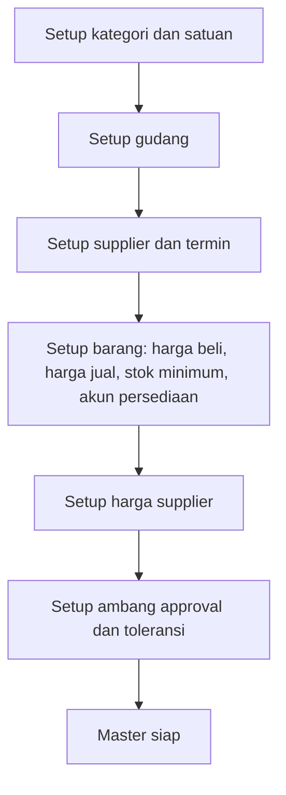
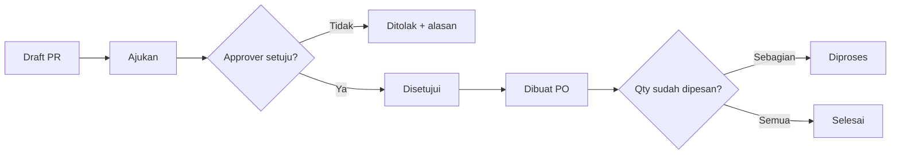
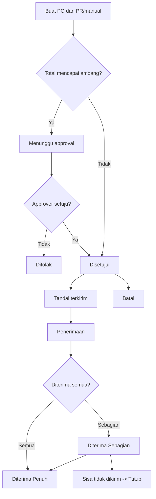
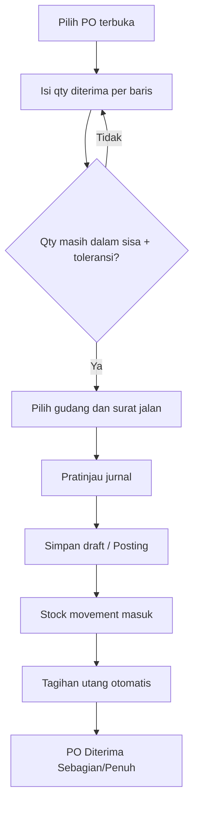
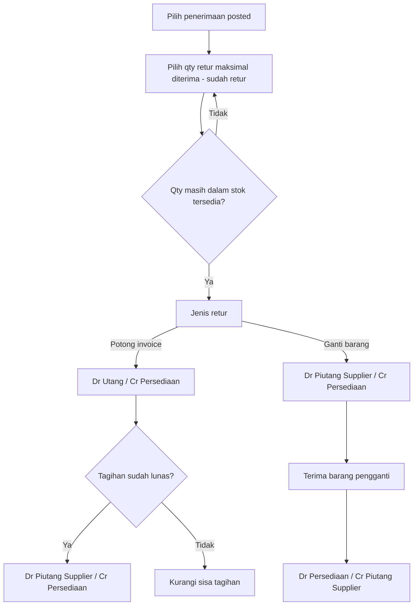
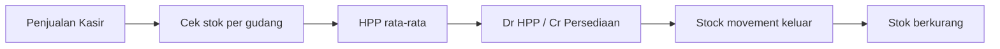
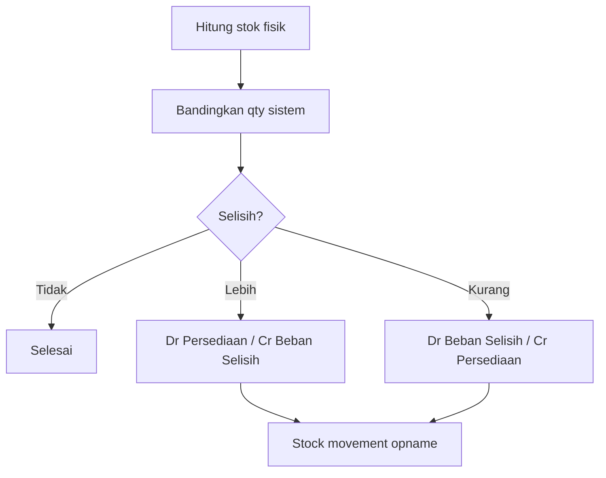

# Flow Logistic & Purchasing — Blueprint Modul Operasional ERP

Versi: 1.0  
Tanggal: 16 November 2026  
Dokumen pasangan: [`flow-finance.md`](./flow-finance.md)  
Referensi implementasi: prototipe `erp-finance-mvp` di repository ini

## 0. Cara memakai dokumen ini

Dokumen ini adalah **blueprint konsep, flow, dan layout dasar** untuk modul Logistik/Purchasing. Dokumen ini tidak terikat pada satu framework atau design system.

Gunakan sebagai:

- spesifikasi perilaku untuk AI agent,
- peta modul untuk sistem ERP lain,
- daftar invariant yang tidak boleh berubah,
- referensi wireframe sebelum implementasi UI,
- checklist acceptance test.

**Yang wajib dipertahankan:** alur PR → PO → penerimaan → utang, aturan stok, status dokumen, dan posting keuangan.  
**Yang dapat disesuaikan:** nama menu, bahasa, komponen UI, warna, ikon, role, dan backend.

## 1. Tujuan dan ruang lingkup

Modul ini mengelola:

- Master barang, kategori, satuan, gudang, dan supplier
- Harga beli dan harga jual
- Purchase Request (PR)
- Purchase Order (PO)
- Penerimaan Barang
- Retur Pembelian
- Penerimaan Pengganti
- Stok dan nilai persediaan
- Penyesuaian stok/opname (opsional)
- Rekonsiliasi stok dengan Buku Besar
- Laporan operasional

**Integrasi opsional:**

- Penjualan/Kasir yang mengurangi stok dan membuat HPP
- Customer bersama Finance
- Multi-warehouse dan transfer
- Batch, expiry, FIFO
- RFQ/perbandingan harga
- Faktur supplier dan three-way match
- PPN dan ongkos kirim

**Di luar cakupan dasar:** manufaktur, produksi, barcode hardware, dan integrasi kurir.

### 1.1 Flag konfigurasi untuk sistem lain

| Flag | Default | Efek |
| --- | --- | --- |
| `logistic.multi_warehouse.enabled` | false | Pemilih gudang, stok per gudang, transfer |
| `logistic.approval.enabled` | true | Approval PR/PO dan ambang |
| `logistic.tolerance.enabled` | true | Toleransi qty penerimaan |
| `logistic.price_list.enabled` | true | Harga supplier per barang |
| `logistic.replacement.enabled` | true | Retur ganti barang + penerimaan pengganti |
| `logistic.stock_adjustment.enabled` | false | Opname dan pengeluaran stok |
| `logistic.batch.enabled` | false | Batch, expiry, FIFO |
| `logistic.unit_conversion.enabled` | false | Konversi satuan |
| `logistic.three_way_match.enabled` | false | Faktur supplier dan pencocokan tiga arah |

Jika flag dimatikan, jangan tampilkan menu/field terkait dan jangan mengubah aturan inti PR → PO → penerimaan → utang.

### 1.2 Integrasi dengan sistem lain

- **Sudah punya WMS/stock system:** jadikan stock movement sebagai adapter; jangan menghitung stok dua kali.
- **Sudah punya procurement/approval:** map status PR/PO ke workflow existing; pertahankan invariant PO → penerimaan → utang.
- **Sudah punya Finance/GL:** posting penerimaan/retur lewat accounting service; jangan menulis jurnal langsung dari UI Logistik.
- **Sudah punya POS:** penjualan mengirim stock-out dan HPP ke modul stok; pastikan idempotensi.
- **Sudah punya master supplier:** gunakan satu sumber data pihak; jangan membuat daftar supplier ganda.

## 2. Prinsip inti

1. **PO adalah komitmen, bukan utang.** Utang diakui saat Penerimaan Barang diposting.
2. **Stok adalah hasil pergerakan.** Posisi dan nilai stok dihitung dari `stock_movements`, bukan diketik manual.
3. **Penilaian stok memakai moving average.** Harga rata-rata dihitung ulang saat barang masuk.
4. **Dokumen posted immutable.** Koreksi lewat retur, penyesuaian, atau dokumen pembalik.
5. **Subledger harus cocok dengan akun kontrol.** Nilai stok = saldo akun Persediaan; sisa tagihan supplier = saldo Utang Usaha.
6. **Tidak boleh stok negatif.** Validasi dilakukan per gudang.
7. **Pemisahan tugas.** Peminta, penyetuju, pembeli, penerima, dan pembayar sebaiknya berbeda.
8. **Qty, harga, dan status tidak boleh dihitung ulang dengan asumsi UI.** Semua validasi ada di domain layer.
9. **Setiap dokumen punya jejak audit.** Pembuat, penyetuju, pem-posting, waktu, dan alasan.

## 3. Aktor dan capability

Gunakan capability agar bisa dipetakan ke role sistem target.

| Capability | Contoh role | Boleh |
| --- | --- | --- |
| `logistic.view` | Auditor, Manager | Lihat master, dokumen, stok |
| `master.manage` | Admin Logistik | Barang, supplier, kategori, satuan, gudang |
| `pr.create` | Pemohon/Staf | Buat dan ajukan PR |
| `pr.approve` | Approver/Manager | Setujui/tolak PR |
| `po.create` | Purchasing | Buat PO dari PR/manual |
| `po.approve` | Approver/Manager | Setujui/tolak PO di atas ambang |
| `po.send` | Purchasing | Tandai PO terkirim, batal, tutup |
| `receipt.create` | Gudang | Buat draft penerimaan |
| `receipt.post` | Gudang | Posting penerimaan |
| `return.create` | Gudang/Purchasing | Buat retur |
| `return.confirm` | Purchasing/Manager | Konfirmasi retur |
| `stock.adjust` | Gudang/Manager | Opname/penyesuaian |
| `logistic.settings` | Admin | Ambang, toleransi, penomoran |
| `logistic.report` | Manager/Auditor | Laporan dan rekonsiliasi |

**Mapping ke prototipe referensi:** `Logistik` menjalankan master, PR, PO, penerimaan, retur, dan stok; `Finance` menyetujui PR/PO, membayar utang, dan menjalankan Kasir. Blueprint ini mendukung role yang lebih rinci untuk sistem target.

**Aturan pemisahan tugas:**

- Pembuat PR tidak boleh menyetujui PR yang sama.
- Pembuat PO tidak boleh menyetujui PO yang sama, kecuali admin dengan audit override.
- Penerimaan hanya oleh Gudang.
- Pembayaran utang hanya Finance.
- Setiap override harus tercatat di audit log.

## 4. Peta modul

| Modul | Fungsi | Wajib |
| --- | --- | --- |
| Dashboard Logistik | PR/PO menunggu, PO terbuka, stok minimum, penerimaan hari ini, rekonsiliasi | Ya |
| Master Barang | SKU, nama, kategori, satuan, harga beli, harga jual, stok minimum, akun persediaan | Ya |
| Master Supplier | Kode, nama, kontak, termin, harga supplier, status | Ya |
| Kategori/Satuan/Gudang | Pengelompokan dan dimensi stok | Ya |
| Purchase Request | Permintaan internal, approval, sisa qty | Ya |
| Purchase Order | Komitmen ke supplier, approval, kirim, batal, tutup | Ya |
| Penerimaan Barang | Stok masuk, tagihan utang, jurnal | Ya |
| Retur Pembelian | Potong tagihan atau ganti barang | Ya |
| Penerimaan Pengganti | Barang pengganti dari retur | Opsional |
| Stok | Posisi, nilai, rata-rata, kartu stok, minimum | Ya |
| Opname/Penyesuaian | Koreksi stok fisik | Opsional |
| Laporan | Stok, pergerakan, PO terbuka, pembelian, rekonsiliasi | Ya |
| Pengaturan | Ambang, toleransi, penomoran, gudang utama | Ya |

## 5. Flow utama

### 5.1 Setup master



Aturan:

- Barang yang sudah dipakai transaksi tidak boleh dihapus; nonaktifkan.
- Satuan tidak boleh diganti setelah ada transaksi.
- Supplier memakai data pihak yang sama dengan Finance.
- Harga supplier menyimpan riwayat; PO mengambil harga terbaru yang berlaku.

### 5.2 Purchase Request



Aturan:

- PR minimal satu barang dengan qty > 0.
- PR tidak membuat jurnal dan tidak mengikat supplier.
- Qty PO tidak boleh melebihi sisa qty PR.
- Satu PR boleh dipecah ke beberapa PO/supplier.
- Penolakan wajib alasan.

### 5.3 Purchase Order



Aturan:

- PO adalah komitmen; tidak ada jurnal/utang saat PO disetujui.
- Harga diambil dari harga supplier atau harga beli standar.
- Harga dan qty divalidasi saat PO dibuat; perubahan setelah posted mengikuti kebijakan revisi.
- PO yang sudah memiliki penerimaan tidak boleh dibatalkan; gunakan tutup.
- Approval threshold dapat berupa nominal total PO.

### 5.4 Penerimaan barang (partial/full)



Aturan:

- Penerimaan harus merujuk PO yang disetujui/dikirim/diterima sebagian.
- Qty boleh sebagian; default sisa PO.
- Toleransi penerimaan default 0; dapat dikonfigurasi.
- Surat jalan disimpan untuk audit.
- Setelah posted tidak diedit; koreksi lewat retur.

### 5.5 Retur pembelian dan pengganti



Aturan:

- Retur wajib merujuk penerimaan posted dan beralasan.
- Qty retur tidak boleh melebihi qty diterima yang belum diretur.
- Qty retur tidak boleh melebihi stok saat ini.
- Retur potong invoice mengurangi tagihan; jika sudah lunas, menjadi Piutang Supplier.
- Retur ganti barang tidak mengubah utang; barang pengganti menambah stok dan mengurangi Piutang Supplier.
- Barang yang sudah terjual tidak bisa diretur melebihi stok tersisa.

### 5.6 Pengeluaran stok dari penjualan (opsional)



Aturan:

- Penjualan tidak boleh melebihi stok.
- HPP dihitung saat transaksi.
- Harga jual tidak boleh 0.
- Jika stok bernilai 0, blokir penjualan atau minta penilaian stok terlebih dahulu.

### 5.7 Opname/penyesuaian stok (opsional)



Aturan:

- Opname membutuhkan alasan.
- Selisih dinilai dengan harga rata-rata saat itu.
- Dokumen posted tidak diedit; koreksi berikutnya membuat penyesuaian baru.

## 6. Status lifecycle

### 6.1 Purchase Request

```text
draft → submitted → approved / rejected → processing → completed
```

Opsional: `cancelled`.

### 6.2 Purchase Order

```text
draft → pending_approval → approved / rejected
approved → sent → partially_received → fully_received → closed
approved → cancelled
```

Di bawah ambang, `pending_approval` dapat dilewati dan langsung `approved`.

### 6.3 Penerimaan

```text
draft → posted → voided (opsional)
```

### 6.4 Retur

```text
draft → confirmed → completed
```

Status pengganti: `waiting → partial → completed`.

### 6.5 Penyesuaian stok

```text
draft → posted → voided (opsional)
```

## 7. Aturan bisnis

- Qty PR/PO/penerimaan/retur harus > 0.
- Diskon/ongkir/PPN dapat menjadi field terpisah; jangan mengubah qty.
- Total PO = Σ(qty × harga) - diskon + ongkir + pajak (jika diaktifkan).
- Approval threshold dibandingkan dengan total PO setelah penyesuaian.
- Penerimaan tidak boleh melebihi sisa PO + toleransi.
- Retur tidak boleh melebihi qty diterima yang belum diretur dan stok tersedia.
- Tidak boleh stok negatif.
- Stok minimum menghasilkan peringatan, bukan blokir otomatis.
- Gudang utama tidak boleh dinonaktifkan.
- Dokumen posted tidak dihapus.
- Setiap dokumen memiliki nomor unik per jenis dan tahun; nomor tidak dipakai ulang.
- Multi-warehouse: stok dan harga rata-rata dihitung per gudang atau per barang, sesuai kebijakan sistem target. Tetapkan satu kebijakan sejak awal.

## 8. Integrasi akuntansi

| Kejadian | Debit | Kredit | Catatan |
| --- | --- | --- | --- |
| PO disetujui | — | — | Hanya komitmen |
| Penerimaan diposting | Persediaan | Utang Usaha | Qty × harga PO; buat tagihan AP |
| Retur potong invoice | Utang Usaha | Persediaan | Mengurangi tagihan; kelebihan jadi Piutang Supplier |
| Retur ganti barang | Piutang Supplier | Persediaan | Utang tidak berubah |
| Penerimaan pengganti | Persediaan | Piutang Supplier | Stok kembali |
| Pembayaran utang | Utang Usaha | Kas/Bank | Oleh Finance |
| Penjualan tunai/bank | Kas/Bank + Diskon | Penjualan | + HPP/Persediaan |
| Penjualan piutang | Piutang Usaha + Diskon | Penjualan | + HPP/Persediaan |
| Opname kurang | Beban Selisih Persediaan | Persediaan | Opsional |
| Opname lebih | Persediaan | Beban Selisih Persediaan | Opsional |

**Akun kontrol:**

- `1-1300 Persediaan` dikunci dari jurnal manual setelah modul aktif.
- `2-1100 Utang Usaha` dikunci dari jurnal manual.
- `1-1500 Piutang Supplier` menampung retur setelah tagihan lunas.
- `5-1200 Beban Selisih Persediaan` hanya jika opname diaktifkan.

## 9. Penilaian stok

Setiap pergerakan menyimpan qty dan nilai:

```text
Stok barang      = Σ qty movement
Nilai persediaan = Σ nilai movement
Harga rata-rata  = Nilai persediaan / Stok
```

| Kejadian | Qty | Nilai |
| --- | ---: | ---: |
| Penerimaan | +qty | +qty × harga PO |
| Retur | -qty | -qty × harga baris penerimaan |
| Penerimaan pengganti | +qty | +qty × harga retur |
| Penjualan | -qty | -qty × harga rata-rata |
| Opname lebih | +selisih | +selisih × harga rata-rata |
| Opname kurang | -selisih | -selisih × harga rata-rata |

Aturan:

- Simpan uang sebagai integer minor unit.
- Nilai persediaan total harus sama dengan saldo akun Persediaan.
- Jangan membawa selisih pembulatan ke laporan lain.
- FIFO/batch dapat menjadi strategi alternatif; pilih satu strategi dan jangan campur tanpa desain migrasi.

## 10. Data model kanonik

### 10.1 items / barang

```text
id, sku, name, category_id, unit_id,
purchase_price, selling_price,
min_stock, manage_stock, inventory_account_id,
status, created_at, updated_at
```

### 10.2 suppliers / parties

```text
id, code, name, type(supplier/customer),
contact, phone, email, address,
payment_terms, status
```

Gunakan satu tabel pihak jika Finance dan Logistik berbagi data.

### 10.3 purchase_requests / lines

```text
purchase_requests:
id, number, date, requester_id, purpose,
status, approved_by, approved_at, reject_reason

purchase_request_lines:
id, pr_id, item_id, qty, note, ordered_qty
```

### 10.4 purchase_orders / lines

```text
purchase_orders:
id, number, date, supplier_id, pr_id,
payment_terms, status, subtotal, discount, tax, total,
notes, approved_by, approved_at, reject_reason

purchase_order_lines:
id, po_id, item_id, qty, price, received_qty, returned_qty
```

### 10.5 receipts / lines

```text
receipts:
id, number, date, po_id, supplier_id, warehouse_id,
delivery_note, status, total, journal_id, invoice_id, type, return_id

receipt_lines:
id, receipt_id, po_line_id, return_line_id,
item_id, qty, price, returned_qty
```

### 10.6 returns / lines

```text
purchase_returns:
id, number, date, receipt_id, po_id, invoice_id,
supplier_id, type(credit_note/replacement), reason,
status, total, ap_reduction, supplier_receivable,
replacement_status, journal_id

purchase_return_lines:
id, return_id, receipt_line_id, item_id,
qty, price, subtotal, replaced_qty
```

### 10.7 stock movements

```text
id, date, item_id, warehouse_id,
type(receipt/return/replacement/sale/adjustment_in/adjustment_out),
qty, value, unit_cost,
ref_type, ref_id, ref_number, created_at
```

`stock_movements` adalah sumber kebenaran stok. Jangan menyimpan saldo stok yang bisa diedit manual.

### 10.8 stock adjustments (opsional)

```text
stock_adjustments:
id, number, date, type(opname/issue), reason, status

stock_adjustment_lines:
id, adjustment_id, item_id, system_qty, physical_qty, issued_qty
```

## 11. Layout dasar UI

Layout berikut adalah pola, bukan tema final. Semua token/komponen mengikuti design system target.

### 11.1 App shell

```text
┌──────────────────────────────────────────────────────────────┐
│ Sidebar / Rail │ Top bar: breadcrumb, gudang aktif, user     │
│   Logistik     ├──────────────────────────────────────────────┤
│   - Dashboard  │ Page header: judul, konteks, aksi utama     │
│   - Master     │ Filter bar                                  │
│   - PR         │ Konten                                      │
│   - PO         │ Tabel / kartu / detail                      │
│   - Penerimaan │ Pagination                                  │
│   - Retur      │                                             │
│   - Stok       │                                             │
│   - Laporan    │                                             │
└──────────────────────────────────────────────────────────────┘
```

Aturan:

- Sidebar bisa rail ikon di layar sempit.
- Pemilih gudang ada di top bar atau page header jika multi-warehouse.
- Angka qty dan uang rata kanan; status memakai badge teks + warna.
- Detail dokumen memakai drawer/halaman; form panjang memakai drawer.

### 11.2 Dashboard Logistik

```text
┌ PR menunggu ┐ ┌ PO menunggu ┐ ┌ PO terbuka ┐ ┌ Stok minimum ┐
│ jumlah      │ │ jumlah      │ │ jumlah     │ │ jumlah       │
└─────────────┘ └─────────────┘ └────────────┘ └──────────────┘

┌ Stok vs Buku Besar ──────────────────────────────────────────────┐
│ Nilai stok | Saldo GL | Selisih | status                         │
└──────────────────────────────────────────────────────────────────┘

┌ Penerimaan hari ini ─────────────┐ ┌ Peringatan stok ───────────┐
│ daftar singkat                   │ │ item di bawah minimum      │
└──────────────────────────────────┘ └────────────────────────────┘
```

### 11.3 Master Barang

```text
[+ Barang] [Cari...] [Kategori ▾] [Status ▾]

Kode | Nama | Kategori | Satuan | Harga beli | Harga jual | Stok | Min | Status
```

Form barang:

- SKU, nama, kategori, satuan
- Harga beli standar, harga jual (jika POS aktif)
- Stok minimum
- Kelola stok
- Akun persediaan
- Status aktif

### 11.4 Purchase Request

```text
[+ Buat PR] [Cari...] [Status ▾]

Nomor | Tanggal | Pemohon | Keperluan | Status | Aksi

Drawer form:
┌ PR baru ───────────────────────────────────────────┐
│ Tanggal [....]  Keperluan [.....................]  │
│ ┌ Barang ────────┬ Qty ┬ Catatan ┬ Hapus ────────┐ │
│ │ [Pilih barang] │     │         │               │ │
│ └────────────────┴─────┴─────────┴───────────────┘ │
│ [+ Baris]                                         │
│ [Simpan draft] [Ajukan]                           │
└───────────────────────────────────────────────────┘
```

### 11.5 Purchase Order

```text
[+ Buat PO] [Cari...] [Status ▾] [Supplier ▾]

Drawer form:
┌ PO baru ──────────────────────────────────────────────────────┐
│ Supplier [....]  Dari PR [....]  Tanggal [....]  Termin [..] │
│ ┌ Barang ───────┬ Qty ┬ Harga ┬ Subtotal ┬ Hapus ───────────┐ │
│ └───────────────┴─────┴───────┴──────────┴──────────────────┘ │
│ Total PO: Rp ...                                             │
│ [Simpan PO]                                                   │
└───────────────────────────────────────────────────────────────┘
```

Detail PO:

- Status, supplier, total, approval
- Qty diterima per baris
- Nomor penerimaan
- Riwayat
- Aksi kirim/batal/tutup

### 11.6 Penerimaan Barang

```text
[+ Buat penerimaan]

Pilih PO [....]  Tanggal [....]  Gudang [....]  Surat jalan [....]

Barang | Sisa PO | Qty diterima | Harga | Subtotal
...
Pratinjau jurnal:
  Dr Persediaan ...
  Cr Utang Usaha ...

[Simpan draft] [Simpan & posting]
```

### 11.7 Retur Pembelian

```text
[+ Buat retur]

Penerimaan [....]  Tanggal [....]  Jenis [potong invoice/ganti barang]
Alasan [....................................................]

Barang | Diterima | Sudah retur | Stok | Qty retur | Harga | Subtotal
...
Pratinjau dampak stok dan utang/piutang supplier
[Simpan draft] [Konfirmasi]
```

### 11.8 Stok

```text
[Gudang ▾] [Kategori ▾] [Cari...]

Kode | Barang | Kategori | Qty | Nilai | Rata-rata | Min | Status
```

Detail barang:

- Kartu stok: tanggal, jenis, qty masuk/keluar, saldo, nilai
- Sumber dokumen
- Peringatan stok minimum
- Rekonsiliasi dengan GL

### 11.9 Opname/Penyesuaian

```text
[+ Penyesuaian]

Jenis [opname/pengeluaran]  Tanggal [....]  Gudang [....]  Alasan [....]

Barang | Qty sistem | Qty fisik/keluar | Selisih | Nilai | Aksi
```

### 11.10 Laporan

- Posisi stok
- Kartu stok
- Stok minimum
- PO terbuka
- Riwayat pembelian per supplier/barang
- Rekonsiliasi stok vs GL
- Ringkasan penerimaan/retur
- Ekspor CSV/PDF (sesuai kemampuan sistem)

## 12. Design system adapter

Gunakan kontrak token/komponen yang sama dengan `flow-finance.md`. Ringkasnya:

| Token/Fungsi | Dipakai untuk |
| --- | --- |
| `color.surface`, `color.surface-muted` | Halaman, card, filter bar |
| `color.text`, `color.text-muted` | Teks utama/sekunder |
| `color.border` | Tabel, card, divider |
| `color.primary`, `color.on-primary` | Aksi utama |
| `color.success/warning/danger/info` | Status dokumen/stok |
| `radius.*`, `font.*`, `density` | Mengikuti sistem target |
| Table | Daftar master/dokumen, qty dan angka rata kanan |
| Badge | Status dan peringatan stok |
| Drawer | Form PR/PO/penerimaan/retur |
| Dialog | Konfirmasi posting/void |
| Toast | Hasil aksi |
| Empty state | Belum ada data + CTA |
| Skeleton | Loading tabel/kartu |

Contoh pemetaan cepat:

| Kebutuhan | Tailwind/shadcn-like | Material UI | Ant Design |
| --- | --- | --- | --- |
| Tombol utama | `Button` primary | `<Button variant="contained">` | `<Button type="primary">` |
| Drawer form | `Sheet` / custom drawer | `<Drawer>` | `<Drawer>` |
| Tabel qty | `Table` + `tabular-nums` | `<Table>` + `fontVariantNumeric` | `<Table>` + CSS numerik |
| Status | `Badge` | `<Chip>` | `<Tag>` |

Aturan UI:

- Jangan memakai warna brand untuk status; gunakan warna semantik.
- Status harus punya teks; jangan hanya warna.
- Tampilkan qty dan satuan secara eksplisit.
- Tampilkan gudang aktif jika multi-warehouse.
- Tabel harus bisa di-scroll horizontal di mobile.
- Form panjang memakai drawer; detail dokumen memakai drawer/halaman.
- Angka uang/qty memakai format lokal dan `tabular-nums`.
- Sediakan state loading, empty, error, disabled, read-only, no-permission.

## 13. Pola interaksi

- PR/PO/penerimaan/retur memakai drawer atau halaman penuh.
- Form kotor meminta konfirmasi sebelum ditutup.
- Posting/konfirmasi memakai dialog dengan ringkasan dampak stok/jurnal.
- Dokumen posted tidak menampilkan tombol edit/delete.
- Aksi baris lebih dari tiga memakai dropdown.
- Peringatan stok minimum tampil sebagai badge dan daftar terpisah.
- Setelah posting, tampilkan nomor dokumen dan tautan ke jurnal/tagihan.

## 14. API/event contract konseptual

### 14.1 Endpoint minimum

```text
GET    /items
POST   /items
PATCH  /items/:id
GET    /suppliers
POST   /suppliers
GET    /purchase-requests
POST   /purchase-requests
POST   /purchase-requests/:id/submit
POST   /purchase-requests/:id/approve
POST   /purchase-requests/:id/reject
GET    /purchase-orders
POST   /purchase-orders
POST   /purchase-orders/:id/approve
POST   /purchase-orders/:id/reject
POST   /purchase-orders/:id/send
POST   /purchase-orders/:id/close
POST   /purchase-orders/:id/cancel
GET    /receipts
POST   /receipts
POST   /receipts/:id/post
GET    /returns
POST   /returns
POST   /returns/:id/confirm
POST   /returns/:id/replacement
GET    /stock?warehouse_id
GET    /stock/movements?item_id
GET    /stock/reconciliation
POST   /stock/adjustments
```

### 14.2 Event domain

```text
pr.submitted
pr.approved
pr.rejected
po.approved
po.sent
receipt.posted
return.confirmed
stock.adjusted
stock.low
```

Event membawa `id`, `source`, `source_id`, `actor`, `timestamp`, dan `idempotency_key`.

### 14.3 Idempotensi

Posting penerimaan/retur/penyesuaian harus idempotent. Gunakan `source_id` atau `Idempotency-Key` agar double submit tidak membuat stok/jurnal ganda.

## 15. Panduan eksekusi untuk AI agent

Urutan implementasi yang disarankan:

1. **L0 — Fondasi:** design tokens, app shell, komponen tabel/form/drawer, format uang/qty/tanggal.
2. **L1 — Master:** barang, kategori, satuan, gudang, supplier, harga supplier.
3. **L2 — PR:** draft, submit, approval, sisa qty.
4. **L3 — PO:** create from PR/manual, threshold approval, send/cancel/close.
5. **L4 — Penerimaan:** partial/full receipt, stock movement, AP invoice, journal.
6. **L5 — Retur:** credit note, replacement, Piutang Supplier.
7. **L6 — Stok:** position, valuation, movement, low stock, reconciliation.
8. **L7 — Opname/pengeluaran:** adjustment dan issue stock (opsional).
9. **L8 — Laporan dan alat belajar:** stock card, open PO, purchase history, reconciliation.

Guardrail:

- Jangan membuat utang saat PO disetujui.
- Jangan mengedit dokumen posted.
- Jangan menyimpan saldo stok manual.
- Jangan memakai qty dari UI tanpa validasi domain.
- Jangan menulis jurnal langsung dari UI; panggil service/domain posting.
- Jangan mengabaikan gudang pada validasi stok.
- Jangan mengasumsikan role name; gunakan capability.
- Setiap perubahan skema wajib migrasi.
- Setiap halaman wajib punya loading/empty/error/no-permission.

## 16. Acceptance test

### 16.1 Skenario dasar purchasing

Prasyarat: modal awal 50.000.000 di Bank BCA; Supplier A termin 30 hari; Semen Rp 65.000/sak; Cat Rp 150.000/kaleng.

| # | Aksi | Hasil |
| --- | --- | --- |
| 1 | PR Semen 100 sak, Cat 20 kaleng | PR draft/diajukan |
| 2 | Approver menyetujui PR | PR approved |
| 3 | PO total 9.500.000 | PO approved; tanpa jurnal |
| 4 | Terima Semen 60, Cat 20 | Stok masuk; AP 6.900.000; PO partial |
| 5 | Terima Semen 40 | Stok 100/20; AP 9.500.000; PO full |

Hasil:

- Nilai persediaan = 9.500.000 = saldo GL Persediaan.
- Sisa utang = 9.500.000 = saldo GL Utang.
- Rekonsiliasi = 0.
- Saldo Bank BCA = 50.000.000.

### 16.2 Retur dan pengganti

- Retur 5 Cat (750.000) potong invoice: stok Cat 15; nilai 8.750.000; utang 8.750.000.
- Retur setelah lunas: Piutang Supplier 750.000.
- Retur ganti barang + penerimaan pengganti: stok kembali; Piutang Supplier 0; utang tidak berubah.

### 16.3 Penjualan stok (opsional)

- Jual 30 Semen: stok 70; nilai persediaan 6.800.000; HPP 1.950.000.
- Saldo GL Persediaan = 6.800.000; rekonsiliasi 0.

### 16.4 Uji validasi

- PO melebihi sisa PR ditolak.
- Penerimaan melebihi sisa PO + toleransi ditolak.
- Retur melebihi qty diterima/stok ditolak.
- Stok negatif ditolak.
- Dokumen posted tidak bisa diedit/dihapus.
- Approval di bawah ambang otomatis.
- Role tanpa capability tidak melihat aksi.

## 17. Perluasan dan non-goals

**Perluasan:** transfer antar gudang, multi-warehouse valuation, batch/expiry, FIFO, unit conversion, RFQ, three-way match, PPN, ongkir/diskon, barcode, dan integrasi kurir.

**Non-goals dasar:** manufaktur, produksi, dan perencanaan kapasitas.

## 18. Mapping ke prototipe referensi

| Blueprint | Referensi di prototipe |
| --- | --- |
| Master barang/supplier | `js/master.js`, halaman master |
| PR/PO | `js/purchasing.js`, `js/pages-purchasing.js` |
| Penerimaan | `js/receiving.js` |
| Retur/pengganti | `js/returns.js` |
| Stok dan moving average | `js/inventory.js` |
| Rekonsiliasi | `js/reconcile.js` |
| Jurnal | `js/ledger.js` |
| Data & migrasi | `js/store.js` |
| Seed/demo | `js/seed-purchasing.js` |
| Role & akses | `js/roles.js`, `js/auth.js` |
| Design system referensi | `index.html` (Tailwind, style komponen) |

Gunakan referensi ini untuk melihat contoh implementasi. Untuk sistem target, ganti framework, komponen, dan token tanpa mengubah invariant bisnis.
